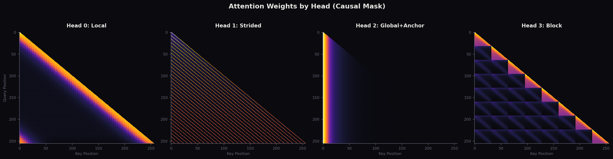
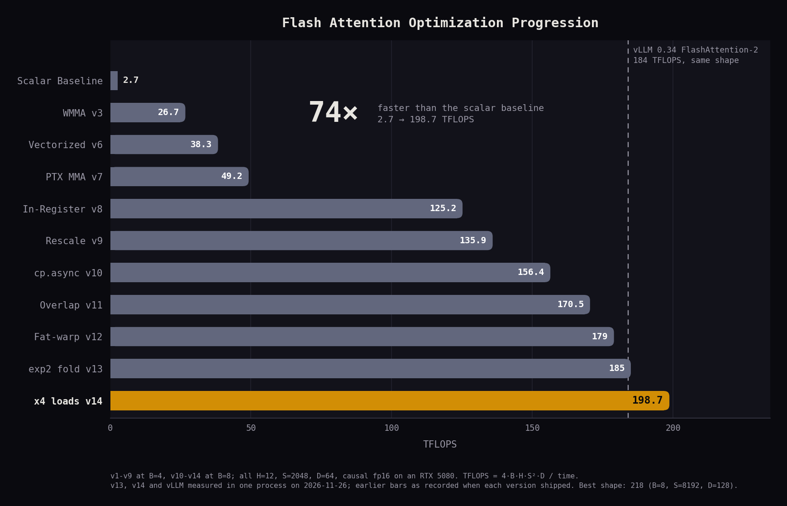
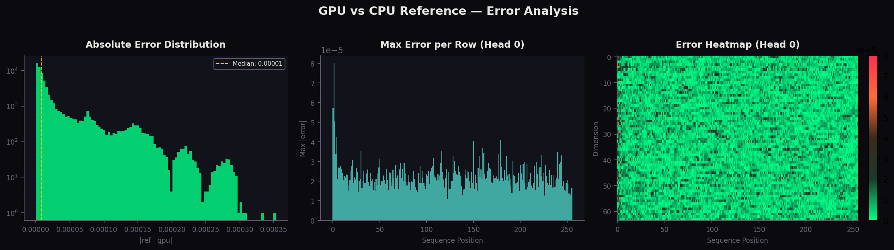

<p align="center">
  
</p>

<h1 align="center">Flash Attention PTX/CUDA</h1>

<p align="center">
  <strong>Hand-written PTX flash attention for consumer NVIDIA GPUs</strong><br>
  Faster than vLLM 0.34's FlashAttention-2 on all 34 benchmarked shapes on an RTX 5080
</p>

<p align="center">
  <a href="#performance">Performance</a> ·
  <a href="#end-to-end-qwen25-15b">End to end</a> ·
  <a href="#using-it">Using it</a> ·
  <a href="#correctness">Correctness</a> ·
  <a href="#how-it-works">How it works</a> ·
  <a href="docs/how-to-use.md">User manual</a>
</p>

---

## What is this?

Flash attention written from scratch in CUDA with inline PTX. It started as a 2.7 TFLOPS scalar kernel and was optimized one measured step at a time.

What it contains:

- **Prefill attention** on tensor cores: fp16 or bf16, head dimension 64 or 128, causal or full, MHA / GQA / MQA, as a padded batch `[B, H, S, D]` or as packed ragged sequences.
- **Decode attention**: one query token against a long KV cache. This is a separate, memory-bound kernel that splits the cache across the GPU.
- **Paged KV cache** with block tables and per-sequence lengths, stored as fp16/bf16, FP8 (half the bytes) or INT4 (under a third), chosen per layer. The cache-write kernel quantizes on the way in and can apply RoPE to K in the same pass.
- **Chunked prefill** against the paged cache for follow-up turns, on all three cache formats.
- **PyTorch bindings** (`fa_ptx`) that trace through `torch.compile` and can be captured in CUDA graphs.
- An opt-in **autotuner** that benchmarks the tile configurations for a batch shape once and reuses the winner.

Scope and limits:

- Inference only. There is no backward pass.
- Head dimensions 64 and 128 only.
- Developed, validated and measured on an RTX 5080 (sm_120). It compiles for sm_80 and later, but other GPUs are untested.
- The kernels use `mma.sync`, `ldmatrix` and `cp.async`, which exist on every NVIDIA GPU from Ampere on. They do not use WGMMA (not available on sm_120) or TMA.

## Performance

<p align="center">
  
</p>

**All 34 benchmarked shapes are ahead of vLLM 0.34's FlashAttention-2**, measured in the same process on an RTX 5080. On the 24 shapes long enough to be kernel-bound the lead is 2.8% to 14%. About ten shapes run in under 0.1 ms and show larger leads (up to 37%), but there the difference is mostly per-call overhead and not kernel speed. Methodology, every table and the caveats are in [docs/vllm-comparison.md](docs/vllm-comparison.md).

| Config (H=12, causal fp16) | TFLOPS | vs vLLM 0.34 FA2 |
|--------|-------:|-----------------:|
| B=1, S=512, D=64 (under 0.1 ms) | 55.1 | +29.6% |
| B=1, S=2048, D=64 (under 0.1 ms) | 149.1 | +16.1% |
| B=4, S=2048, D=64 | 187.6 | +9.3% |
| B=8, S=2048, D=128 | 189.2 | +8.2% |
| B=8, S=4096, D=64 (tightest margin of the 34) | 211.6 | +2.8% |
| B=8, S=8192, D=128 (peak) | 217.9 | +4.3% |

**How to read the TFLOPS numbers.** They are `4·B·H·S²·D / time`, the FLOP count of full (non-causal) attention, applied to both kernels. Causal attention executes about half of that work, and the FlashAttention repository's own benchmark halves the count for causal runs. By that convention every figure here is half as large (the peak is about 109). The numbers are useful for comparing kernels on the same shape. They are not tensor-core utilization.

For utilization, Nsight Compute reports a tensor-pipe utilization of 84.35% for this kernel and 84.5% for vLLM's FlashAttention-2 (B=8, S=2048, D=128, measured on v13).

### Optimization progression

Each version removed one measured bottleneck.

| Version | TFLOPS | What changed |
|---------|-------:|------|
| v1 | 2.7 | Scalar fp32 baseline, no tensor cores |
| v3 | 26.7 | Tensor cores through WMMA |
| v6 | 38.3 | Vectorized 16-byte global loads |
| v7 | 49.2 | Raw PTX `mma.sync` and `ldmatrix`, which have a known register layout |
| v8 | 125.2 | Softmax moved into registers; the score matrix no longer round-trips through shared memory |
| v9 | 135.9 | Probabilities computed directly against the new row maximum |
| v10 | 156.4 | `cp.async` copies global memory straight into shared memory |
| v11 | 170.5 | P stored in the K tile's memory (2 to 3 blocks per SM); V load overlapped with compute |
| v12 | 179 | New 4-warp kernel: each warp owns whole rows and P stays in registers |
| v13 | 185 | Softmax in base 2: the scale folds into the score multiply and every exponential is one instruction |
| v14 | 198.7 | K and V operands loaded four matrices per `ldmatrix`; only tiles that need a mask are masked |

v1 to v9 were measured at B=4 and v10 to v14 at B=8, all at H=12, S=2048, D=64, causal fp16. v13 and v14 were measured in one process with vLLM on 2026-11-26; earlier rows are as recorded when each version shipped.

## End to end: Qwen2.5-1.5B

[python/e2e_qwen.py](python/e2e_qwen.py) runs Qwen2.5-1.5B (bf16, 28 layers, 12 query heads over 2 KV heads, head dimension 128) with every attention operation on this library, through the `fa_ptx` bindings. Prefill is packed varlen attention. Decode uses a paged KV cache per layer, and the whole decode step (projections, cache write, attention, MLP, logits, argmax) is captured in one CUDA graph, so generating a token is a single `graph.replay()`.

Same GPU and model against vLLM 0.23. This comparison has not been re-run against vLLM 0.34.

| | This repo (`--compile` + CUDA graph) | vLLM 0.23 (FA2 backend, CUDA graphs) |
|---|---|---|
| Decode, B=1 | 4.70 ms/token (213 tok/s) | 5.12 ms/token (195 tok/s) |
| Decode, B=8 | 5.28 ms/step (1516 tok/s) | 5.43 ms/step (1472 tok/s) |
| Prefill 128 tokens, B=1 | 7.1 to 11 ms | 10.4 ms |
| Prefill 128 tokens, B=8 | 31.2 ms | 32.1 ms |

Decode is about 9% faster at B=1 and 3% at B=8. Prefill is at parity. Three things to keep in mind:

- vLLM is a full serving engine, and its numbers include scheduler and sampler work. This runner is a minimal loop. The table shows what the kernels and a graph-first API can reach, not a serving-engine win.
- The numbers need `--compile`. With the CUDA graph alone, decode takes 5.53 ms/token at B=1, which is slower than vLLM.
- Run-to-run spread on a desktop GPU is 5 to 15%. These are the best of 3 runs; vLLM's are its own benchmark's average of 5.

With a bf16 cache the model agrees with transformers on 61 of 64 teacher-forced tokens.

A quantized cache has to be chosen per layer. Quantizing every layer alike damages this model: over 1,161 tokens of prose, FP8 keeps 83.6% of the next-token choices an fp16 cache makes and INT4 keeps 3.9%. Almost all of that comes from layer 0, whose K has a few channels about 300 times larger than the rest. With that layer's cache left in fp16, FP8 keeps 96.1% at 1.93× less memory. INT4 with layers 0, 1 and 15 in fp16 keeps 94.3% at 2.59× less. The layers are found by measurement (`fa_ptx.kv_logit_noise`, or `--fp16-layers auto` in the runner). Details are in [docs/e2e-model-test.md](docs/e2e-model-test.md).

```sh
python python/e2e_qwen.py --verify --gen 64          # parity gates vs transformers
python python/e2e_qwen.py --bench --batch 1 --prompt-len 128 --gen 256 --compile
```

## Using it

The user manual is [docs/how-to-use.md](docs/how-to-use.md) (also as a [styled page](docs/how_to_use.html)): building and linking, the three-call API, ragged prompts, and a complete continuous-batching loop over a quantized paged cache. [docs/api-guide.md](docs/api-guide.md) is the field-by-field reference.

### Requirements

- CUDA Toolkit. Built and tested with 13.1. The default build targets sm_80, 86, 89, 90 and 120, and sm_120 needs CUDA 12.8 or newer.
- CMake 3.20 or newer and a C++17 compiler.
- An NVIDIA GPU with compute capability 8.0 or higher. Only the RTX 5080 has been tested.

### Build

```bash
git clone https://github.com/Tugbars/Flash-Attention-PTX-CUDA.git
cd Flash-Attention-PTX-CUDA
mkdir build && cd build
cmake .. -DCMAKE_BUILD_TYPE=Release
cmake --build . --target flash_demo flash_bench
```

To build for one GPU only, which is much faster, change `CMAKE_CUDA_ARCHITECTURES` near the top of [CMakeLists.txt](CMakeLists.txt) (for example to `"120"` for an RTX 5080).

### C++

```cpp
#include "flash_attention.h"
using namespace transformer;

FaAttentionArgs a = {};
a.Q = q; a.K = k; a.V = v; a.O = o;   // device pointers, [B, H, S, D] fp16, 16-byte aligned
a.batch_size = B; a.num_heads = H; a.seq_len = S; a.d_head = 128;
a.causal = true;                      // scale = 0 means 1/sqrt(d_head)
cudaError_t err = fa_attention(a);    // check it: a rejected call writes nothing
```

### Python

`pip install -e python/` (needs `nvcc` and a CUDA build of PyTorch), or import `fa_ptx` from the `python/` folder and it builds itself on first use.

```python
import fa_ptx
o = fa_ptx.attention(q, k, v, causal=True)   # q, k, v: [B, H, S, D] CUDA fp16 or bf16
```

### Demo

```bash
./flash_demo                           # run the kernel, check it, dump data
python ../scripts/visualize.py .       # draw the figures into ./figures
```

Excerpt of the output:

```
  GPU: NVIDIA GeForce RTX 5080 (84 SMs, CC 12.0)

[1] Generating structured Q, K, V (B=1, H=4, S=256, D=64)
[3] Running GPU flash attention kernel...
  Average: 0.0163 ms
[4] Correctness check...
  Max absolute error: 0.000353
  Normalized RMSE:    0.001503
  Bad elements:       0 / 65536
  Result:             PASS ✓
```

The demo runs four synthetic heads (local, strided, global with an anchor column, block) at a deliberately tiny shape, so its timing says nothing about throughput. Use `flash_bench` for that. The image at the top of this page is the demo's attention map.

## Correctness

Nine gate programs in [tests/](tests/) cover the prefill kernels, decode, the cache formats and the API. Each exits 0 on pass.

- Seven compare against double-precision CPU references on random unit-variance inputs. The pass limits are a normalized RMSE below 1e-3 for fp16 and 6e-3 for bf16. Measured error is about 2.5e-4 for fp16 and 2e-3 for bf16.
- The quantized caches are checked against a reference that dequantizes the same stored values, which separates kernel error from quantization error. Kernel error stays at the same floor. The formats themselves cost about 0.035 (FP8) and 0.10 (INT4) normalized RMSE on gaussian data.
- One checks that the three-call API produces bit-identical output to the underlying launchers.
- One checks the error contract: every rejected argument returns `cudaErrorInvalidValue` without launching a kernel or writing to the output. Nothing in the library aborts the process.

The Python bindings have their own 27-check suite, [python/test_fa_ptx.py](python/test_fa_ptx.py).

```bash
cmake --build . --target fa_validate fa_varlen_validate fa_paged_validate \
                        fa_fp8_validate fa_int4_validate \
                        fa_paged_prefill_validate fa_quant_prefill_validate \
                        fa_api_validate fa_error_validate
```

<p align="center">
  
</p>

Demo output against its CPU reference: median absolute error 1e-5, maximum 3.5e-4.

## How it works

The prefill path has two kernels, both in [kernels/fa_prefill_kernels.cuh](kernels/fa_prefill_kernels.cuh). Both compute `Q·Kᵀ` and `P·V` with `mma.sync.aligned.m16n8k16` and run the softmax in registers, directly on the first product's accumulators.

- **Split-Q** (64×64 tile, 4 warps). Each warp owns 16 query rows across the full key width, so the softmax needs only shuffles inside a warp. Q and the probabilities stay in registers: the softmax output is packed straight into the second multiply's operand. Shared memory holds just the K and V tiles (about 35 KB at D=128, 2 blocks per SM), which stream in with `cp.async` behind the matrix multiplies. This is the kernel behind the numbers above.
- **Split-N** (32-row tile, 4 warps). Half the rows per block means twice as many blocks, which fills the GPU when a workload is too small to saturate it.

The launcher chooses per call:

```
blocks = B * H * ceil(S / 64)
blocks <  SAT_MULT * sm_count    split-N
blocks >= SAT_MULT * sm_count    split-Q
```

`SAT_MULT` is 3 for D=64 and 2 for D=128, both measured crossovers. Ragged and paged prefill always use split-Q. Setting `autotune` replaces the rule with a measurement: the candidate tiles are benchmarked once per shape and the winner is cached, on disk too if `FA_WISDOM` is set.

Decode is a different problem (one query row, bandwidth-bound, no tensor cores) and has its own kernels in [kernels/flash_attention_decode.cu](kernels/flash_attention_decode.cu).

The full engineering story, including the experiments that did not work, is in two browser pages: [docs/flash_attention_story.html](docs/flash_attention_story.html) for prefill and [docs/flash_attention_decode_story.html](docs/flash_attention_decode_story.html) for decode and the KV cache.

## Repository layout

```
├── include/flash_attention.h       public API: three calls, the KvCache descriptor, launch params
├── kernels/
│   ├── fa_prefill_kernels.cuh      both prefill kernels
│   ├── ptx_intrinsics.cuh          PTX wrappers: mma.sync, ldmatrix, cp.async
│   ├── flash_attention.cu          prefill launchers, tile dispatch, autotune candidates
│   ├── flash_attention_decode.cu   decode kernels, quantized KV pools, cache writer
│   ├── fa_api.cu                   the three-call facade (validation and routing)
│   └── fa_autotune.cu, .h          autotuner
├── python/                         fa_ptx bindings, test_fa_ptx.py, e2e_qwen.py
├── tests/                          nine C++ gates
├── src/                            demo.cu, bench.cu
├── scripts/                        visualize.py, figures/, demo data
└── docs/
    ├── how-to-use.md, how_to_use.html    user manual
    ├── api-guide.md                      API reference
    ├── vllm-comparison.md                kernel comparison with vLLM FlashAttention-2
    ├── e2e-model-test.md                 the Qwen2.5-1.5B test
    ├── cutlass-comparison.md             comparison with CUTLASS on an RTX 5080
    └── flash_attention_story.html, flash_attention_decode_story.html
```

## License

MIT
